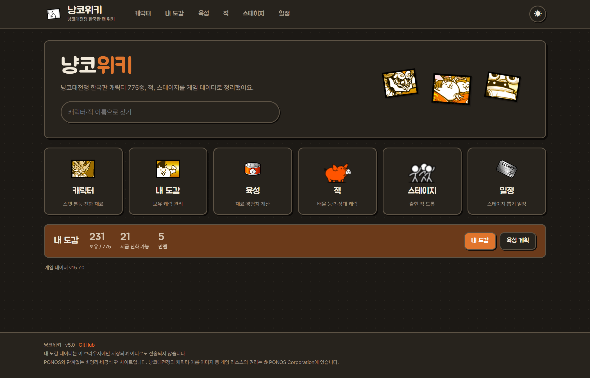
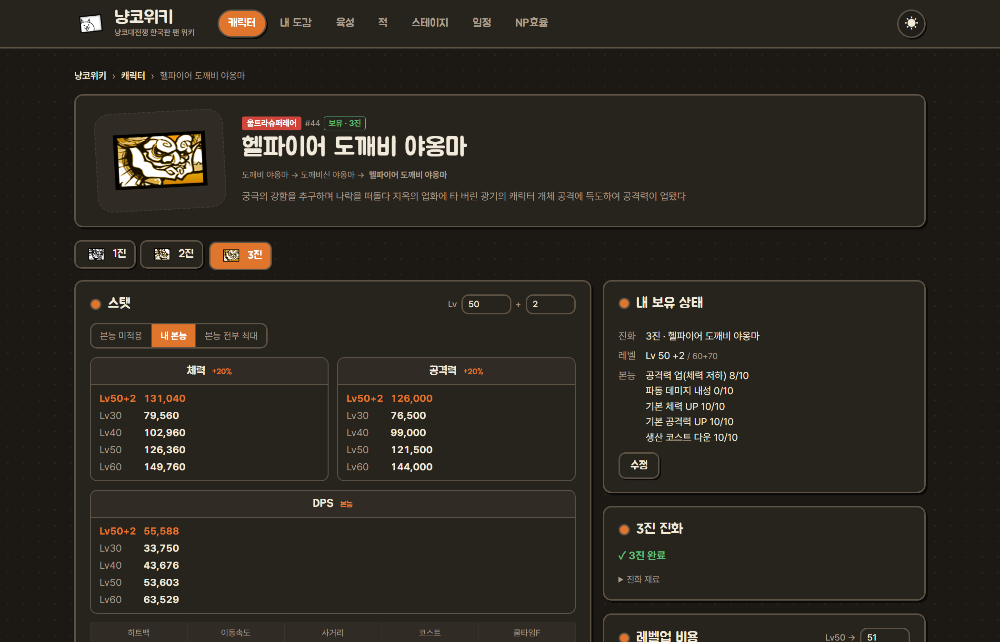
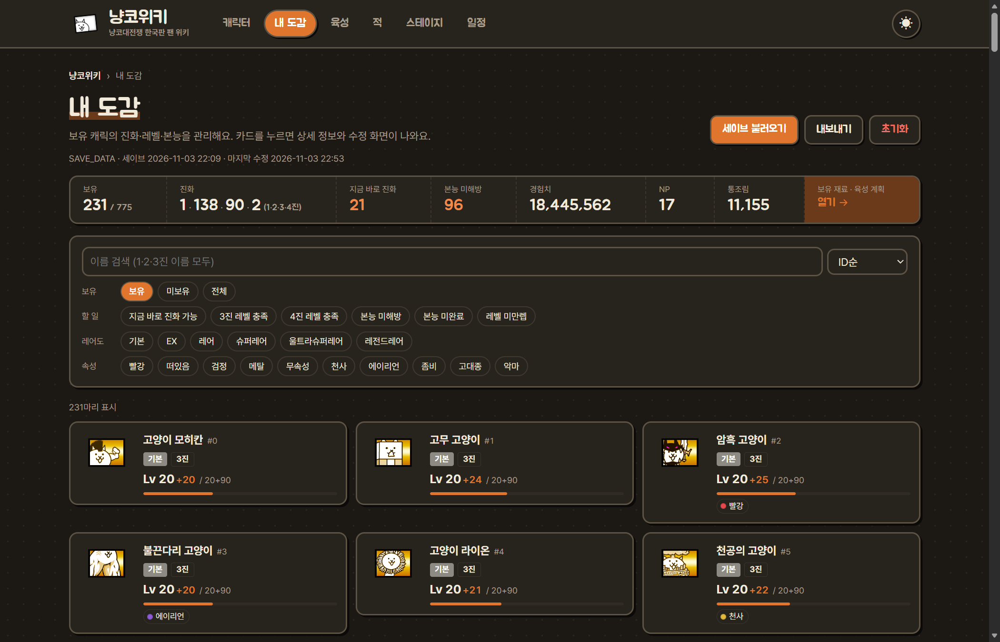
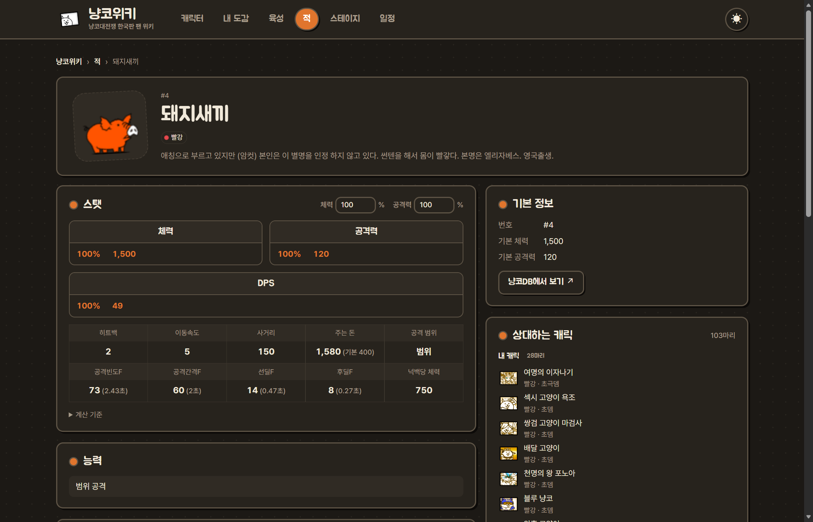
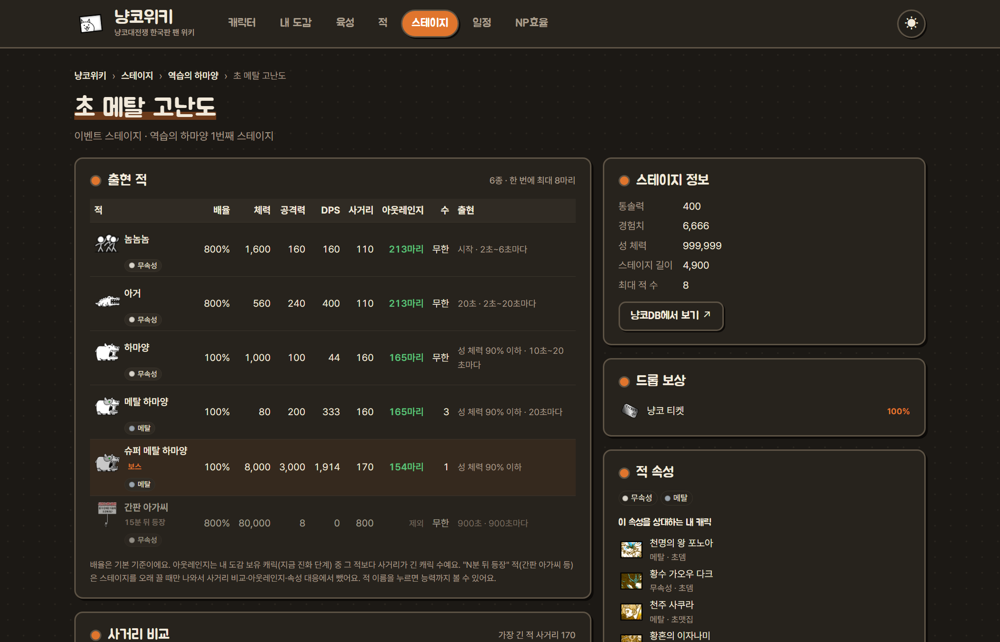
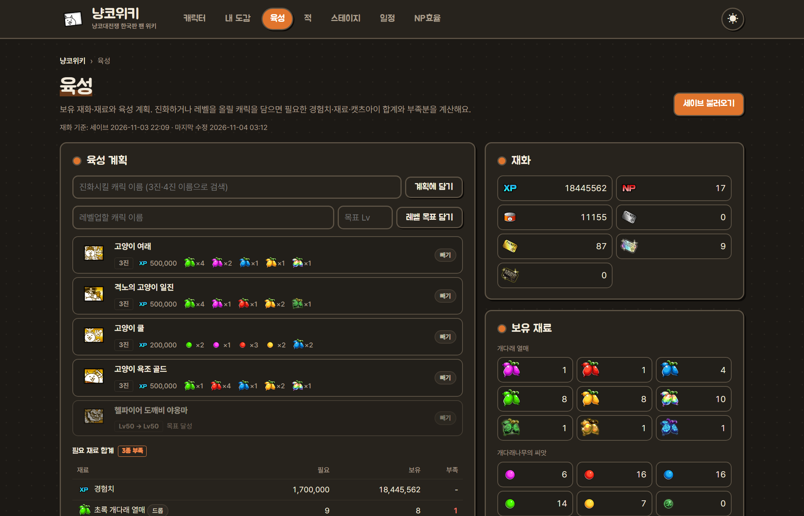
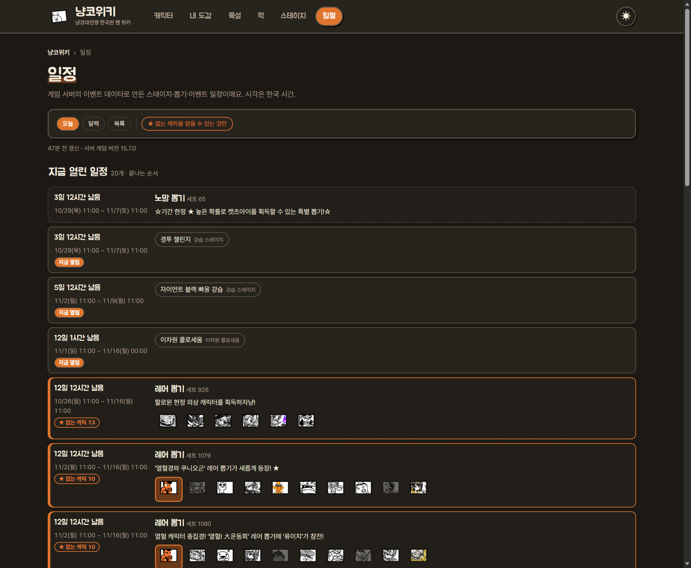
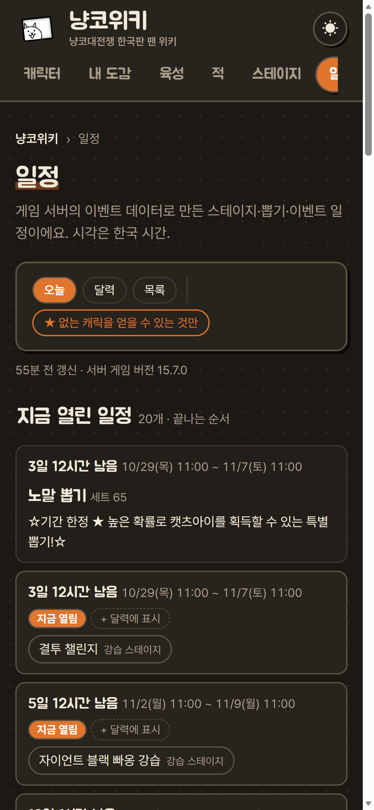

# 냥코위키

**냥코대전쟁(한국판) 캐릭터·적·스테이지 데이터, 이벤트 일정, 내 육성 현황을 한눈에**

## 냥코위키가 뭔가요?

냥코는 오래된 게임이라 편의성이 아쉽습니다. 캐릭 스탯 하나 보려 해도 여기저기 찾아봐야 하고, 캐릭은 수백 마리인데 누구를 3진 했는지, 몇 레벨인지, 본능은 어디까지 찍었는지 게임 안에서 한눈에 볼 방법이 없습니다.

냥코위키는 **캐릭터·적·스테이지 데이터 찾아보기**와 **내 육성 현황 관리**를 한 사이트에 모았습니다.

- 모든 정보는 게임 데이터에서 직접 뽑아서 만듭니다. 게임이 업데이트되면 데이터만 다시 뽑으면 반영됩니다.
- 📱 폰에서도 됩니다. 세이브 불러오기만 PC 프로그램이 필요하고(블루스택 또는 이어하기 코드), 찾아보기·내 도감 직접 입력·육성 계획·일정은 폰에서도 그대로 쓸 수 있습니다.
- 내 도감에 입력한 데이터는 내 브라우저에만 저장되고 어디로도 전송되지 않습니다.
- 📅 v5.0부터 스테이지·뽑기 일정을 보여주고, 폰 계정 그대로 이어하기 코드로 세이브를 불러올 수 있습니다.
- 🌙 v4.0부터 화면을 새로 꾸몄습니다. 홈에서 캐릭터·적 이름을 바로 검색할 수 있고, 오른쪽 위 버튼으로 밝게·어둡게 화면을 바꿀 수 있습니다.

## 주요 기능

### 🐾 캐릭터

아군 캐릭 775종 목록(레어도·속성·얻는 방법 필터)과 캐릭별 상세 페이지. 상세 페이지에서 냥코DB로 바로 갈 수 있습니다.

- **진화 단계별 스탯**: 원하는 레벨과 Lv30·40·50·60의 체력·공격력·DPS(보물 최대 기준, 엄강·맷집·초뎀 범위 포함), 히트백·이동 속도·사거리·코스트, 쿨타임(연구력 Lv20+10·보물 최대 기준)·공격빈도·공격간격·선딜·후딜 프레임, 연속 공격은 타격별 선딜·유효 사거리
- **본능 적용 스탯**: [본능 미적용 / 내 본능 / 본능 전부 최대]를 골라서 비교. 체력·공격력 %, 이동 속도, 넉백, 코스트, 쿨타임, 공격 간격까지 반영하고, 본능으로 바뀐 칸은 주황색으로 표시 (3진부터 적용, 보유 캐릭은 내 본능이 기본)
- **상황별 공격력**: 공격력 업(체력 저하) 발동, 엄청 강하다(×1.8)·초 데미지(×4) 대상, 혼신의 일격, 크리티컬(×2) 때의 실제 공격력
- **타겟 속성·특수 능력**: 빨강·떠있음·검정 등 타겟과 파동·쉴드·초생명체 같은 능력. 본능으로 생기거나 강해진 능력엔 "본능" 표시
- **본능 설명**, **3진·4진 진화 재료**(필요 레벨·경험치·재료, 이미 진화한 단계는 "3진 완료"로 표시)
- **본능옥**: 슬롯이 있는 캐릭은 종류·대상 속성·등급(D부터 S까지)을 골라 끼워볼 수 있습니다. 데미지 업·엄청 강하다 강화·초 데미지 강화는 상황별 공격력에, 데미지 경감·맷집 강화는 효과 목록에 반영됩니다.
- **내 보유 상태**: 내 도감에 넣은 정보가 상세 페이지에도 뜨고, 거기서 바로 수정. 진화 재료 옆에 내 보유량·부족분 표시
- **얻는 방법** (v3.0): 기본 캐릭 해금 스테이지·구매 경험치, 냥코 뽑기·레어 뽑기, 스테이지 드롭(어느 스테이지에서 몇 %). 뽑기 배너 이름은 게임 서버 정보라 표시하지 않습니다.
- **레벨업 비용** (v3.0): 목표 레벨까지 필요한 경험치와 캣츠아이(다크 포함). 51레벨 이상 경험치는 추정값입니다.

### 📒 내 도감

- **세이브 불러오기**: PC 추출 도구로 내 세이브를 읽어서 보유 캐릭·진화·레벨+플러스·본능을 한 번에 채웁니다. 블루스택에서 읽거나, 폰에서 발급한 **이어하기 코드**로 불러올 수 있습니다. 수백 마리를 일일이 입력하지 않아도 됩니다.
- **직접 수정**: 캐릭을 눌러 보유 여부, 진화 단계, 레벨+플러스, 본능 레벨을 고칩니다. 세이브 없이 처음부터 직접 입력해도 됩니다.
- **할 일 필터**: **지금 바로 진화 가능**(레벨·재료 모두 충족), 3진·4진 레벨 충족, 본능 미해방·미완료, 레벨 미만렙만 골라보기
- **레어도·속성 필터**, **검색·정렬**(1·2·3진 이름 모두 검색, ID·레어도·레벨 순)
- **자동 저장·백업**: 브라우저에 자동 저장, [내보내기]로 파일 백업 후 다른 기기에서 불러오기

### 👾 적 (v3.0 · v4.0)

- **적 595종** 목록: 이름 검색, 속성 필터(악마·초생명체·초수·초현자 등), 능력 필터(파동·열파·쉴드·워프·부활 등), 체력·공격력·DPS·사거리·이동속도순 정렬
- **적 상세**: 체력·공격력 배율을 직접 넣어 계산, DPS·공격빈도·선딜·후딜 프레임, 주는 돈(보물 최대 기준), 넉백당 체력, 능력(파동·열파·쉴드·베리어·워프 등)
- **등장 스테이지**: 이 적이 나오는 맵·스테이지 목록
- **상대하는 캐릭** (v4.0): 이 적의 속성을 타겟으로 엄청 강하다·초 데미지·초극 데미지·맷집·초 맷집을 가진 캐릭. 내 도감 캐릭이 먼저 나오고, 본능으로 생기는 경우·아직 진화가 덜 된 경우도 표시합니다.
- 냥코DB·나무위키 적 문서와 수치를 대조했습니다.

### 🗺️ 스테이지 (v3.0 · v4.0)

- **5,600여 개 스테이지**: 메인 스토리(세계편·미래편·우주편, 좀비 습격), 레전드 스토리·신 레전드·제로 레전드, 이벤트·콜라보·강습·고전장·냥코탑·승단 시험·지하 미궁 등
- **스테이지 상세**: ★ 난이도별 적 배율, 적마다 체력·공격력·DPS·사거리·출현 조건(성 체력 %, 시간, 처치 수), 통솔력·성 체력·스테이지 길이, 드롭 보상과 확률
- **사거리 비교**: 이 스테이지 적과 내 캐릭의 사거리를 막대로 비교하고, 적마다 "아웃레인지"(그 적보다 사거리가 긴 내 캐릭 수)를 보여줍니다.
- **속성 대응**: 스테이지 적 속성을 상대하는 내 캐릭(엄청 강하다·초 데미지·맷집 등)
- **냥코DB 링크** (v4.0): 일본판에도 있는 스테이지는 냥코DB 같은 스테이지로 바로 갈 수 있습니다. 세계편처럼 한국판에만 있는 맵은 링크가 없습니다.

### 🌱 육성 (v2.0 · v3.0)

- **재화·재료**: 세이브에서 경험치·NP·통조림·티켓, 개다래 씨앗·열매, 수석, 캐츠아이, 본능옥 보유량을 불러옵니다. 직접 고쳐도 됩니다.
- **지금 바로 진화 가능**: 보유 캐릭 중 레벨과 재료가 모두 충족된 캐릭 목록
- **육성 계획**: 진화시키고 싶은 캐릭(3진·4진)과 레벨 목표(v3.0)를 담으면 필요한 경험치·재료·캣츠아이 합계와 부족분을 계산합니다.
- **재료 드롭 스테이지** (v3.0): 개다래·씨앗·수석·캣츠아이마다 드롭하는 스테이지를 확률 높은 순으로 보여줍니다. 부족한 재료 옆 [드롭] 버튼으로 바로 찾을 수 있습니다.
- **보유 본능옥**: 세이브 기준 본능옥을 등급별로 보여줍니다.

### 📅 일정 (v5.0)

- **오늘**: 지금 열린 기간 한정 일정을 끝나는 순서로, "3일 12시간 남음"처럼 남은 시간과 함께 보여줍니다. 게릴라 경험치처럼 시간이 정해진 스테이지는 **오늘 시간표**(24시간 막대)로, 7일 안에 시작하는 일정은 **곧 시작**으로 모았습니다.
- **★ 없는 캐릭**: 내 도감을 불러왔으면, 내가 아직 없는 캐릭을 얻을 수 있는 뽑기(없는 캐릭 수)와 스테이지(드롭, ★ 표시)를 표시하고 그것만 골라볼 수 있습니다. 뽑기 캐릭 중 이미 가진 캐릭은 흐리게 보입니다.
- **달력**: 기간 한정 뽑기(주황)·이벤트(초록)는 항상, 스테이지(파랑)는 **내가 고른 것만** 달력에 막대로 그립니다. 고른 스테이지는 브라우저에 기억되고, 같은 맵이 다음에 또 열려도 그대로 표시됩니다. 날짜나 막대를 누르면 그날 열리는 일정이 나옵니다.
- **목록**: 진행 중 / 예정 / 전부, 상시 이벤트 포함 여부를 골라서 볼 수 있습니다. 뽑기는 배너 문구와 대표 캐릭·울트라슈퍼레어 이상 캐릭, 스테이지는 맵 링크와 요일·시간 조건을 보여줍니다.
- 일정은 일정 읽기 전용으로 만든 별도 계정으로 받습니다. 사용자 계정은 쓰지 않습니다.

## 사용법

### 1. 캐릭 찾아보기 (폰 · PC)

[냥코위키](https://crexont.github.io/nyanko-wiki/) 접속 → 상단 [캐릭터] → 이름을 검색하거나 목록에서 캐릭 누르기. 상세 페이지에서 레벨을 바꿔가며 스탯을 보고, 본능 버튼으로 본능을 찍었을 때와 비교할 수 있습니다. 상단 [적]·[스테이지]도 같은 방식으로 찾아볼 수 있고, 스테이지 상세에서는 내 도감 캐릭과 사거리를 비교해 줍니다.

### 2. 내 도감 직접 입력 (폰 · PC)

상단 [내 도감] → [직접 입력할게요] → 가진 캐릭을 눌러 보유·진화·레벨·본능 입력 → 자동 저장

### 3. 세이브로 내 도감 채우기 (PC)

[Releases](../../releases/latest)에서 `NyankoWiki-<버전>-win64.zip`을 받아 압축을 풉니다. 파이썬·7-Zip 설치는 필요 없습니다. `NyankoWiki.exe`를 실행하면 방법을 고르는 화면이 나옵니다.

**방법 1. 블루스택 5에서 불러오기**

1. 블루스택 5의 냥코(한국판)에 계정을 옮기고 게임을 한 번 실행합니다.
2. 블루스택을 **완전히 종료**합니다 (작업 표시줄 트레이 아이콘까지).
3. `NyankoWiki.exe` → **1번**을 고르면 같은 폴더에 `냥코_세이브.json`이 생기고 [내 도감]이 열립니다.
4. [세이브 불러오기]를 누르거나 json 파일을 화면에 끌어다 놓습니다.

**방법 2. 이어하기 코드로 불러오기 (폰 계정 그대로)**

1. 폰의 냥코에서 **기종변경(이어하기) 코드**를 발급합니다.
2. `NyankoWiki.exe` → **2번** → 이어하기 코드와 인증번호를 입력합니다.
3. 세이브를 받아 `냥코_세이브.json`을 만든 뒤, **받은 세이브를 그대로 다시 올려 새 이어하기 코드**를 화면에 보여줍니다. 창을 닫아도 프로그램 폴더의 `이어하기_코드.txt`에 남아 있습니다.
4. 폰 냥코 첫 화면 → 이어하기에 **새 코드**를 넣으면 그대로 계속할 수 있습니다.
5. [내 도감]에서 [세이브 불러오기]로 json 파일을 엽니다.

이어하기 코드는 한 번 쓰면 사라져서, 받은 세이브를 다시 올려 새 코드를 발급하는 단계가 꼭 필요합니다. 세이브 내용은 한 글자도 바꾸지 않습니다. 받은 세이브는 `build/transfer/` 폴더에 백업되고, 다시 올리기가 실패하면 화면에 나오는 `--retry` 명령으로 다시 시도할 수 있습니다.

게임을 더 진행했다면 같은 방법으로 다시 하면 됩니다. 이미 입력된 내 도감이 있으면 **[전부 바꾸기]** 또는 **[재화·재료만]**을 고를 수 있습니다. 재화·재료만 바꾸면 직접 고친 캐릭 정보는 그대로 남고, 육성 계획·본능옥 선택은 어느 쪽이든 유지됩니다. 방법 1에서 폰으로 돌아갈 땐 블루스택에서 다시 기종변경 코드를 발급받아 폰에 입력하면 됩니다 (게임의 정상 기능).

> **처음 실행할 때 "Windows의 PC 보호" 창이 뜨면** [추가 정보] → [실행]을 누르세요. 코드 서명을 하지 않은 개인 프로젝트라 뜨는 경고입니다.

 

## 🤔 어느 방법이 좋나요?

- **블루스택(방법 1)**: PC 안의 세이브 파일을 읽기만 해서 게임 서버와 통신하지 않습니다. 대신 계정을 블루스택으로 옮겨야 합니다.
- **이어하기 코드(방법 2)**: 폰 계정 그대로 됩니다. 대신 게임 서버에서 세이브를 받고, 같은 세이브를 다시 올려 새 코드를 받는 과정이 있습니다 (게임에서 기종변경할 때와 같은 서버 기능).
- **이어하기 코드를 프로그램에 넣는 게 찜찜하다면 블루스택(방법 1)을 쓰세요.** 방법 1은 게임 서버와 통신하지 않고 PC 안의 파일만 읽습니다.
- 웹사이트에서 바로 불러오지 않는 이유: 게임 서버가 브라우저 요청을 막고 있고, 이어하기 코드를 냥코위키 서버로 받지 않기 위해서입니다. 코드는 내 PC에서 게임 서버로만 갑니다.

PC가 없어도 내 도감에 직접 입력하면 모든 기능을 똑같이 쓸 수 있습니다.

## 🔒 계정은 괜찮나요?

- 방법 1은 블루스택 가상 디스크(`C:\ProgramData\BlueStacks_nxt\Engine\<인스턴스>\Data.vhdx`)에서 `SAVE_DATA`를 **읽기만** 합니다.
- 방법 2는 이어하기 코드로 게임 서버에서 세이브를 받고, **받은 그대로** 다시 올려 새 이어하기 코드를 받습니다. 세이브 수정은 어느 방법에서도 하지 않습니다.
- 이어하기 코드는 비밀번호와 같습니다. 남에게 보여주지 말고, 냥코위키는 코드를 어디로도 보내지 않습니다 (내 PC → 게임 서버만). 새로 받은 코드만 내 PC의 `이어하기_코드.txt`에 적어 두니, 이 파일도 남에게 보여주지 마세요.
- 세이브는 [BCSFE](https://github.com/fieryhenry/BCSFE-Python)로 읽어서 보유 캐릭·진화·레벨·본능만 `냥코_세이브.json`에 담습니다.
- 내 도감 데이터는 내 브라우저에만 저장되고 어디로도 전송되지 않습니다.
- 소스 코드는 전부 이 저장소에 공개되어 있습니다.

인스턴스가 여러 개면 세이브가 가장 최근인 인스턴스를 고릅니다. 직접 지정하려면 명령 프롬프트에서 `NyankoWiki.exe --instance Pie64`처럼 실행하세요.

## ❓ 문제 해결

| 증상 | 해결 |
|---|---|
| "Windows의 PC 보호" 창이 뜸 | [추가 정보] → [실행] |
| 백신이 exe를 막음 | PyInstaller로 만든 exe에서 생기는 오탐입니다. 백신에서 NyankoWiki 폴더를 예외로 추가한 뒤 다시 실행 |
| "블루스택이 실행 중입니다" | 블루스택을 트레이 아이콘까지 완전히 종료한 뒤 다시 실행 |
| "블루스택 5 인스턴스를 찾지 못했습니다" | 블루스택 5가 설치돼 있는지 확인 (블루스택 4 이하는 미지원) |
| "세이브가 있는 인스턴스가 없습니다" | 블루스택에서 냥코(한국판)로 계정을 옮겨 한 번 실행한 뒤 종료하고 재시도 |
| 이어하기 코드로 "세이브를 받지 못함" | 코드·인증번호를 다시 확인. 이 경우 코드는 소모되지 않습니다 |
| 이어하기 코드로 받았는데 "다시 올리기 실패" | 화면에 나온 `NyankoWiki.exe --retry "…"` 명령을 명령 프롬프트에서 실행하면 새 코드를 다시 받습니다. 받은 세이브는 `build/transfer/`에 있습니다 |
| 내 도감에 입력한 내용이 사라짐 | 브라우저 방문 기록·사이트 데이터를 지우면 함께 지워집니다. [내보내기]로 백업해 두세요 |
| 업데이트했다는데 화면이 예전 그대로 | PC는 Ctrl + F5, 폰은 시크릿 탭으로 열어보세요 |
| 스탯이 게임과 다름 · 새 캐릭이 안 보임 | 캐릭 이름 + 레벨 + 어떤 수치인지 [이슈](../../issues)로 알려 주세요 |

## 다음 업데이트 예정

1. 스테이지·캐릭터 공략 제보 받기
2. 일정 메뉴 (계정을 건드리지 않는 방법을 찾으면)
3. 블루스택 안드로이드 11 이상 인스턴스 지원 확인

## 라이선스

Copyright (C) 2026 crexont

[GPL-3.0](LICENSE) 라이선스입니다. 세이브를 읽는 데 쓰는 BCSFE가 GPL-3.0이라서 같은 라이선스를 따릅니다.

- 누구나 자유롭게 쓰고, 고치고, 다시 배포할 수 있습니다.
- 고쳐서 배포할 때는 소스 코드도 같은 GPL-3.0으로 공개하고, 원래 저작권 표시를 남겨야 합니다.
- 냥코대전쟁의 캐릭터·이름·이미지 같은 게임 리소스는 이 라이선스의 대상이 아닙니다.

## 크레딧

- [BCSFE-Python](https://github.com/fieryhenry/BCSFE-Python): 세이브 파싱, 게임 데이터 다운로드
- [BCData](https://git.battlecatsmodding.org/fieryhenry/BCData): 캐릭터 이름·스탯·레어도·본능 데이터
- [Battle Cats Ultimate](https://github.com/battlecatsultimate/BCU_java_util_common): 스탯·본능·DPS 계산, 적·스테이지 데이터 해석 방식 참고
- [tbcml](https://github.com/fieryhenry/tbcml): 적·스테이지 파일 형식 참고
- [냥코대전쟁 DB](https://battlecats-db.com/), [나무위키](https://namu.wiki/w/%EB%83%A5%EC%BD%94%20%EB%8C%80%EC%A0%84%EC%9F%81): 계산 결과 대조. 게임 데이터에 그림이 없는 적 "간판 아가씨" 아이콘만 나무위키 이미지를 씁니다.
- [7-Zip](https://www.7-zip.org): 가상 디스크 읽기. 배포판에 `7z.exe`, `7z.dll`을 동봉하며 라이선스는 `7z/License.txt`를 따릅니다.

냥코위키는 수익을 목적으로 하지 않는 비영리·비공식 팬 사이트입니다. 냥코대전쟁의 캐릭터·이름·이미지 등 게임 리소스의 권리는 © PONOS Corporation에 있습니다.
